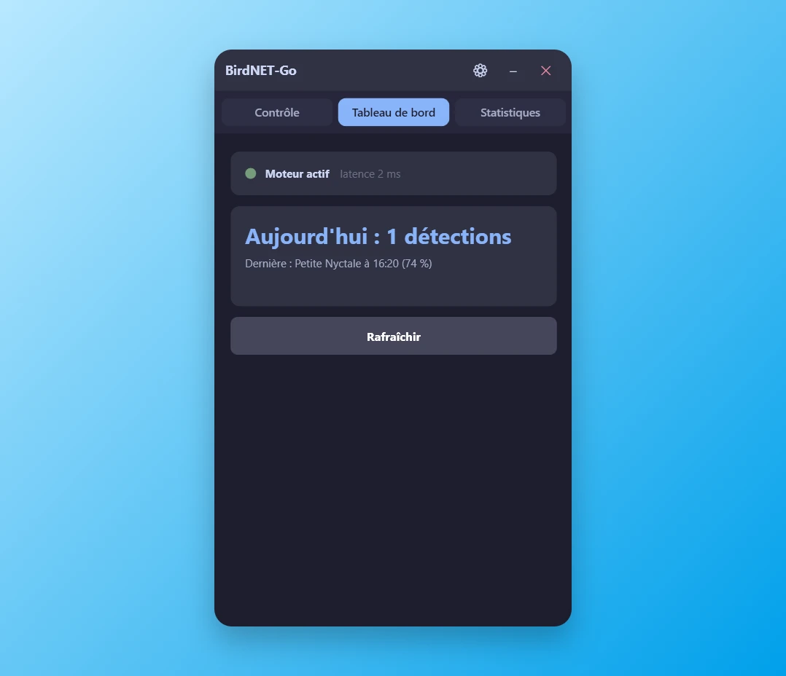

  
  <h1>🐦 BirdNET-Go Control — Guide d'installation et Panneau de contrôle</h1>
  
<strong>Installez et gérez BirdNET-Go en 1 clic sur Windows, Linux, Raspberry Pi et macOS.</strong> 
  Panneau de contrôle WPF multilingue, installateurs vérifiés SHA-256, mises à jour automatiques.

  

    
    
    
  

  
<em>⚠️ <strong>Projet communautaire non officiel.</strong> Le moteur BirdNET-Go provient directement de <a href="https://github.com/tphakala/birdnet-go">tphakala/birdnet-go</a>.</em>

<h2>🚀 Installation rapide</h2>

Téléchargez la dernière version depuis les <a href="https://github.com/timeobonnin-prog/Installation-automatique-de-Birdnet-go/releases">Releases</a> :

<table>
  <thead>
    <tr>
      <th>Plateforme</th>
      <th>Fichier</th>
      <th>Commande d'installation</th>
    </tr>
  </thead>
  <tbody>
    <tr>
      <td>🪟 <strong>Windows</strong></td>
      <td><code>BirdNET-Go-Windows.exe</code></td>
      <td>Double-clic, ou utilisez le <code>.zip</code> portable sans installation</td>
    </tr>
    <tr>
      <td>🐧 <strong>Linux x64</strong></td>
      <td><code>BirdNET-Go-Linux-x64.deb</code></td>
      <td><code>sudo apt install ./BirdNET-Go-Linux-x64.deb</code></td>
    </tr>
    <tr>
      <td>🍓 <strong>Raspberry Pi</strong></td>
      <td><code>BirdNET-Go-RaspberryPi.deb</code></td>
      <td><code>sudo apt install ./BirdNET-Go-RaspberryPi.deb</code></td>
    </tr>
    <tr>
      <td>🍎 <strong>macOS (ARM)</strong></td>
      <td><code>BirdNET-Go-macOS.pkg</code></td>
      <td>Double-clic sur le paquet</td>
    </tr>
  </tbody>
</table>
<blockquote>💡 <strong>Astuce :</strong> les releases sont générées automatiquement chaque jour à 15h55 UTC ou à chaque nouveau tag.</blockquote>

<h2>✨ Fonctionnalités principales</h2>
<ul>
  <li>🎛️ <strong>Contrôle serveur</strong> : démarrage/arrêt du moteur en 1 clic, watchdog anti-crash (3 redémarrages auto), synchronisation du port avec le <code>config.yaml</code> du moteur.</li>
  <li>📊 <strong>Résultats en direct</strong> : pastille de statut, latence en ms, compteur de détections du jour et dernière espèce identifiée.</li>
  <li>📈 <strong>Statistiques avancées</strong> : graphique sparkline sur 24h, top 5 des espèces, export des données en CSV.</li>
  <li>🔄 <strong>Mises à jour in-app</strong> : mise à jour du contrôleur et du moteur en 1 clic, avec vérification cryptographique SHA-256 avant installation.</li>
  <li>🌍 <strong>16 langues</strong> : FR, EN, DE, ES, IT, PT, NL, PL, CS, SK, HU, DA, SV, NB, FI, LV (avec aperçu instantané des traductions).</li>
  <li>💾 <strong>Backup / Restore</strong> : sauvegarde et restauration zip horodatée de tous les réglages et de la configuration du moteur.</li>
  <li>📜 <strong>Visionneuse de logs</strong> : interface intégrée pour consulter les journaux d'activité en temps réel.</li>
  <li>⌨️ <strong>Raccourci global</strong> : <code>Ctrl+Alt+B</code> pour afficher/masquer l'application depuis n'importe où.</li>
  <li>🔒 <strong>Single-instance</strong> : protection par mutex et NamedPipe pour éviter les doublons d'exécution.</li>
  <li>📦 <strong>Self-contained</strong> : aucun runtime .NET externe requis chez l'utilisateur final.</li>
</ul>

<h2>🔐 Sécurité et transparence</h2>
<ol>
  <li><strong>Source officielle</strong> : les binaires du moteur BirdNET-Go sont téléchargés directement depuis les releases de <code>tphakala/birdnet-go</code>, jamais recompilés ni modifiés.</li>
  <li><strong>SHA-256 vérifié</strong> : chaque installateur est hashé et comparé au digest officiel de GitHub avant exécution. Toute différence annule l'installation.</li>
  <li><strong>100 % open source</strong> : l'intégralité du code source du panneau de contrôle est disponible dans le dossier <code>src/</code> et est entièrement auditable.</li>
  <li><strong>Canal de mise à jour statique</strong> : l'application lit un simple fichier <code>update.json</code> hébergé sur GitHub Pages (aucun quota d'API GitHub, aucune limite de débit).</li>
</ol>

<h2>🖥️ Captures d'écran</h2>
<table>
  <thead>
    <tr>
      <th>Contrôle</th>
      <th>Résultats</th>
      <th>Statistiques</th>
    </tr>
  </thead>
  <tbody>
    <tr>
      <td></td>
      <td></td>
      <td></td>
    </tr>
  </tbody>
</table>

<h2>⚙️ Paramètres d'installation avancés (Windows)</h2>

L'installateur Inno Setup prend en charge plusieurs paramètres en ligne de commande pour les déploiements automatisés :

<ul>
  <li><strong>Port personnalisé</strong> (défaut 8080) :
    <pre><code>BirdNET-Go-Windows.exe /VERYSILENT /PORT=9090</code></pre>
  </li>
  <li><strong>Mode réparation</strong> (réinstalle sans toucher aux réglages existants) :
    <pre><code>BirdNET-Go-Windows.exe /REPAIR</code></pre>
  </li>
  <li><strong>Installation silencieuse complète</strong> :
    <pre><code>BirdNET-Go-Windows.exe /VERYSILENT /SUPPRESSMSGBOXES /NORESTART /PORT=8080</code></pre>
  </li>
</ul>

<h2>🏗️ Développement</h2>

Pour lancer l'application en mode développement :

<pre><code>dotnet run --project src/BirdNET-Go-Control.csproj</code></pre>

<strong>Prérequis :</strong> .NET 8 SDK, environnement Windows (pour WPF).

<h2>🤝 Contribuer</h2>

Les Pull Requests sont les bienvenues ! Avant d'ouvrir une PR, veuillez vous assurer que :

<ol>
  <li>La commande <code>dotnet build src/BirdNET-Go-Control.csproj</code> passe sans erreur.</li>
  <li>Les nouvelles clés de traduction sont ajoutées dans <code>src/Loc.cs</code> pour les 16 langues si vous ajoutez du texte visible.</li>
  <li>Les messages de commit suivent la norme <a href="https://www.conventionalcommits.org/">Conventional Commits</a>.</li>
</ol>

<h2>📄 Licence</h2>

Ce projet est sous licence <strong>MIT</strong>. Voir le fichier <a href="docs/LICENSE"><code>LICENSE</code></a> pour plus de détails.

<blockquote><strong>Non affilié</strong> au projet officiel BirdNET-Go de Tomi P. Hakala (<a href="https://github.com/tphakala/birdnet-go">tphakala/birdnet-go</a>), que nous remercions chaleureusement pour leur excellent travail.</blockquote>
