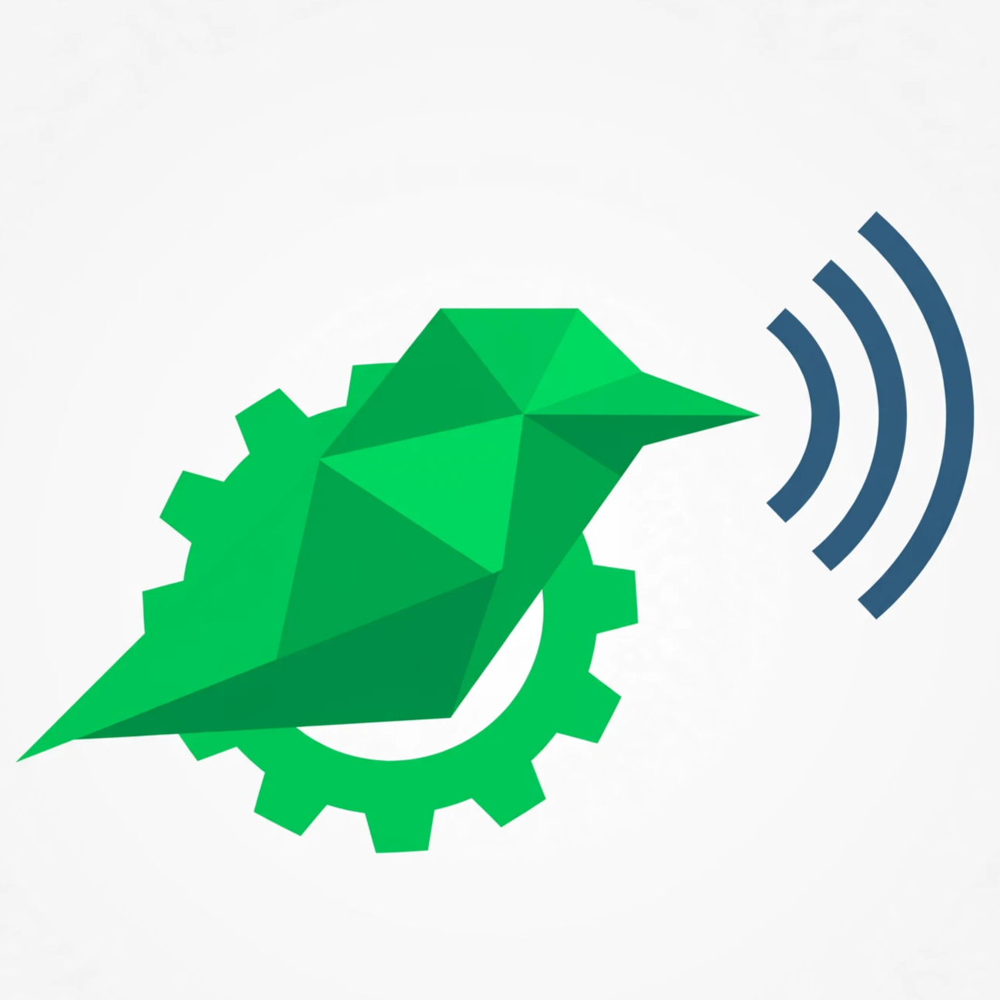

  

## 🪶 Installation automatique de BirdNET-Go

Ce dépôt fournit des installateurs automatisés pour déployer facilement la dernière version de [BirdNET-Go](https://github.com/tphakala/birdnet-go) sur **Windows**, **Linux (Debian/Ubuntu)**, **Raspberry Pi** et **macOS**.

Chaque mise à jour est détectée automatiquement, compilée, testée, scannée par VirusTotal, et publiée dans la section Releases.

---

## 📥 Installation sur Windows (x64 / ARM64)

1. Rendez-vous dans la section [**Releases**](../../releases).
2. Téléchargez le fichier **`BirdNET-Go-Installer.exe`** (environ 96 Mo).
3. Double-cliquez dessus. L'installateur fera tout le travail : il créera un raccourci sur votre Bureau, ajoutera le dossier au PATH de Windows, et vous proposera de lancer l'application.

**Note :** Cet installateur est "hors-ligne". Il contient déjà le binaire et les modèles d'IA. Il ne télécharge rien.

### ⚠️ Avertissement Windows SmartScreen
Cet exécutable n'étant pas encore signé numériquement, Windows peut afficher un écran bleu : *"Windows a protégé votre PC"*. Cliquez sur **"Informations complémentaires"** puis **"Exécuter quand même"**.

---

## 🐧 Installation sur Linux (Debian/Ubuntu) et 🍓 Raspberry Pi

Téléchargez le fichier **`.deb`** correspondant à votre architecture (amd64 pour PC, arm64 pour Raspberry Pi) dans les Releases, puis installez-le :

    sudo dpkg -i birdnet-go_*.deb

Le service `systemd` sera configuré et démarré automatiquement. L'interface est accessible sur `http://localhost:8080`.

---

## 🍎 Installation sur macOS

Téléchargez le fichier **`.pkg`** correspondant à votre processeur (Intel ou Apple Silicon) dans les Releases. Double-cliquez dessus pour lancer l'assistant d'installation Apple.

---

## 🛡️ Sécurité et Vérification d'intégrité

Chaque version est analysée par VirusTotal. Grâce à notre installateur "hors-ligne", le taux de faux positifs est extrêmement faible.

**1. Analyse VirusTotal**
Un lien direct vers le rapport est fourni dans chaque Release.

**2. Empreinte SHA-256**
Pour vérifier l'intégrité du fichier `.exe` (sous PowerShell) :

    Get-FileHash .\BirdNET-Go-Installer.exe -Algorithm SHA256

---

## 🔏 Code signing policy

Free code signing provided by [SignPath.io](https://signpath.io/), certificate by [SignPath Foundation](https://signpath.org/).

- **Committers and reviewers:** [timeobonnin-prog](https://github.com/timeobonnin-prog)
- **Approvers:** [timeobonnin-prog](https://github.com/timeobonnin-prog)
- **Privacy policy:** This program will not transfer any information to other networked systems unless specifically requested by the user or the person installing or operating it.

---
*Projet open source sous licence MIT. Non affilié officiellement au projet BirdNET-Go.*
