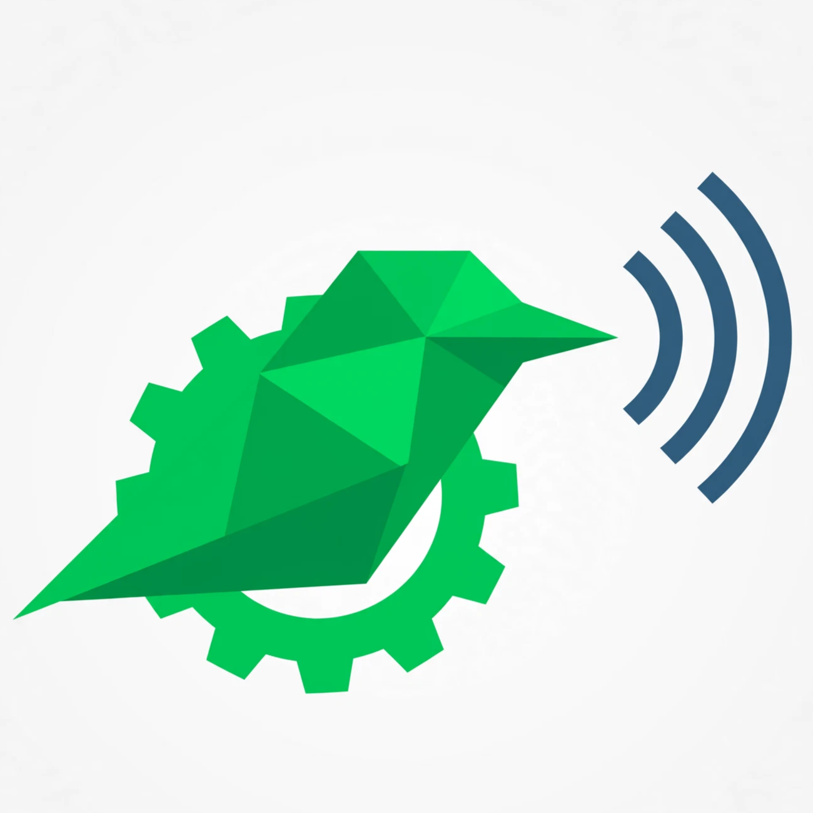
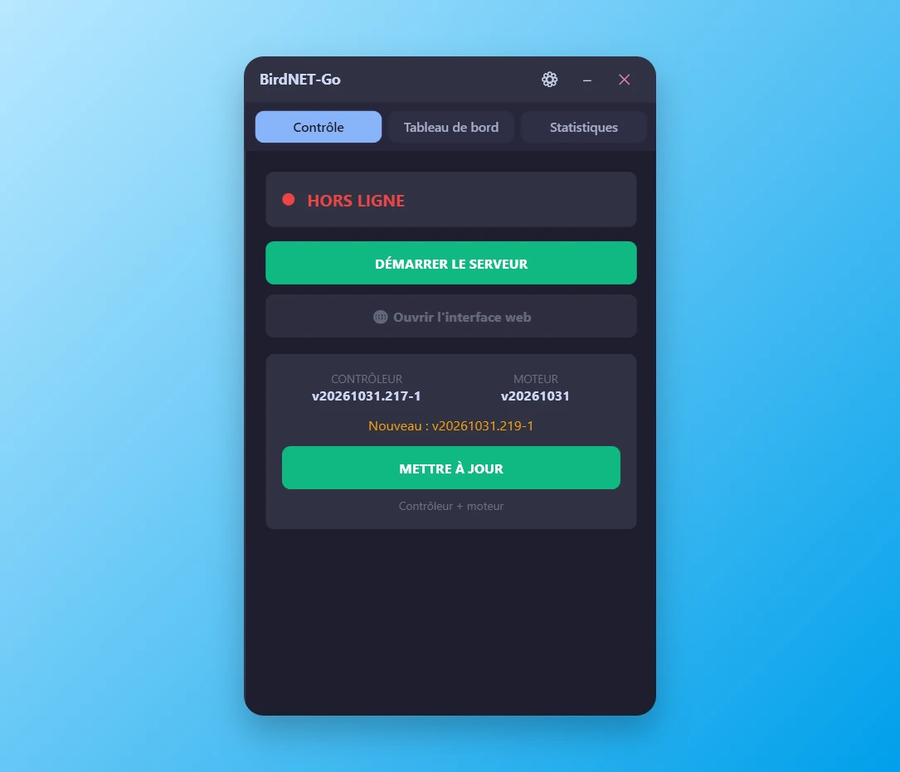
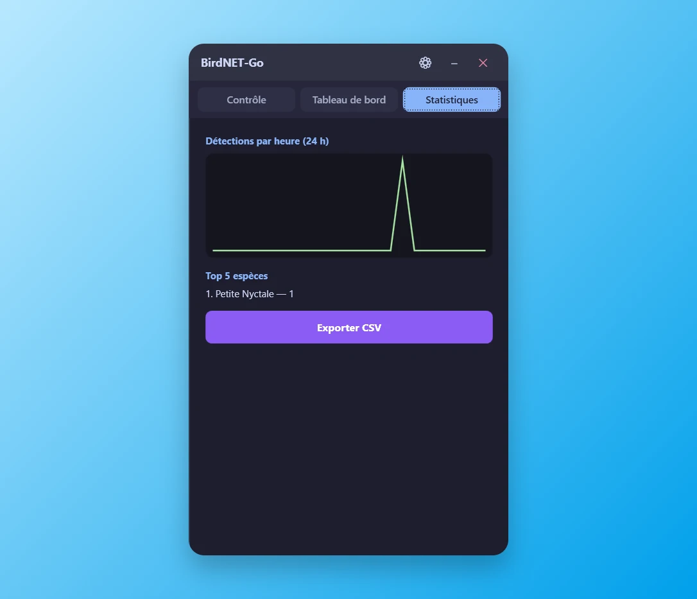

<div align="center">
  
  <h1>🐦 BirdNET-Go Control — Guide d'installation et Panneau de contrôle</h1>
  <p><strong>Installez et gérez BirdNET-Go en 1 clic sur Windows, Linux, Raspberry Pi et macOS.</strong><br>
  Panneau de contrôle WPF multilingue, installateurs vérifiés SHA-256, mises à jour automatiques.</p>
  
  <p>
    <a href="https://github.com/timeobonnin-prog/Installation-automatique-de-Birdnet-go/actions/workflows/build-and-release.yml"></a>
    
    
  </p>
  
  <p><em>⚠️ <strong>Projet communautaire non officiel.</strong> Le moteur BirdNET-Go provient directement de <a href="https://github.com/tphakala/birdnet-go">tphakala/birdnet-go</a>.</em></p>
</div>

---

## 🚀 Installation rapide

Téléchargez la dernière version depuis les [Releases](https://github.com/timeobonnin-prog/Installation-automatique-de-Birdnet-go/releases) :

| Plateforme      | Fichier                      | Commande d'installation                                      |
| :-------------- | :--------------------------- | :----------------------------------------------------------- |
| 🪟 **Windows**      | `BirdNET-Go-Windows.exe`     | Double-clic, ou utilisez le `.zip` portable sans installation |
| 🐧 **Linux x64**    | `BirdNET-Go-Linux-x64.deb`   | `sudo apt install ./BirdNET-Go-Linux-x64.deb`                |
| 🍓 **Raspberry Pi** | `BirdNET-Go-RaspberryPi.deb` | `sudo apt install ./BirdNET-Go-RaspberryPi.deb`              |
| 🍎 **macOS (ARM)**  | `BirdNET-Go-macOS.pkg`       | Double-clic sur le paquet                                    |

> 💡 **Astuce** : Les releases sont générées automatiquement chaque jour à 15h55 UTC ou à chaque nouveau tag.

---

## ✨ Fonctionnalités principales

- 🎛️ **Contrôle serveur** : Démarrage/arrêt du moteur en 1 clic, watchdog anti-crash (3 redémarrages auto), synchronisation du port avec le `config.yaml` du moteur.
- 📊 **Résultats en direct** : Pastille de statut, latence en ms, compteur de détections du jour et dernière espèce identifiée.
- 📈 **Statistiques avancées** : Graphique sparkline sur 24h, top 5 des espèces, export des données en CSV.
- 🔄 **Mises à jour in-app** : Mise à jour du contrôleur et du moteur en 1 clic, avec vérification cryptographique SHA-256 avant installation.
- 🌍 **16 langues** : FR, EN, DE, ES, IT, PT, NL, PL, CS, SK, HU, DA, SV, NB, FI, LV (avec aperçu instantané des traductions).
- 💾 **Backup / Restore** : Sauvegarde et restauration zip horodatée de tous les réglages et de la configuration du moteur.
- 📜 **Visionneuse de logs** : Interface intégrée pour consulter les journaux d'activité en temps réel.
- ⌨️ **Raccourci global** : `Ctrl+Alt+B` pour afficher/masquer l'application depuis n'importe où.
- 🔒 **Single-instance** : Protection par mutex et NamedPipe pour éviter les doublons d'exécution.
- 📦 **Self-contained** : Aucun runtime .NET externe requis chez l'utilisateur final.

---

## 🔐 Sécurité et transparence

1. **Source officielle** : Les binaires du moteur BirdNET-Go sont téléchargés directement depuis les releases de `tphakala/birdnet-go`, jamais recompilés ni modifiés.
2. **SHA-256 vérifié** : Chaque installateur est hashé et comparé au digest officiel de GitHub avant exécution. Toute différence annule l'installation.
3. **100 % open source** : L'intégralité du code source du panneau de contrôle est disponible dans le dossier `src/` et est entièrement auditable.
4. **Canal de mise à jour statique** : L'application lit un simple fichier `update.json` hébergé sur GitHub Pages (aucun quota d'API GitHub, aucune limite de débit).

---

## 🖥️ Captures d'écran

| Contrôle | Résultats | Statistiques |
| :---: | :---: | :---: |
| [](screenshots/control.webp) | [](screenshots/results.webp) | [](screenshots/stats.webp) |

---

## ⚙️ Paramètres d'installation avancés (Windows)

L'installateur Inno Setup prend en charge plusieurs paramètres en ligne de commande pour les déploiements automatisés :

- **Port personnalisé** (défaut 8080) :  
  ```cmd
  BirdNET-Go-Windows.exe /VERYSILENT /PORT=9090
